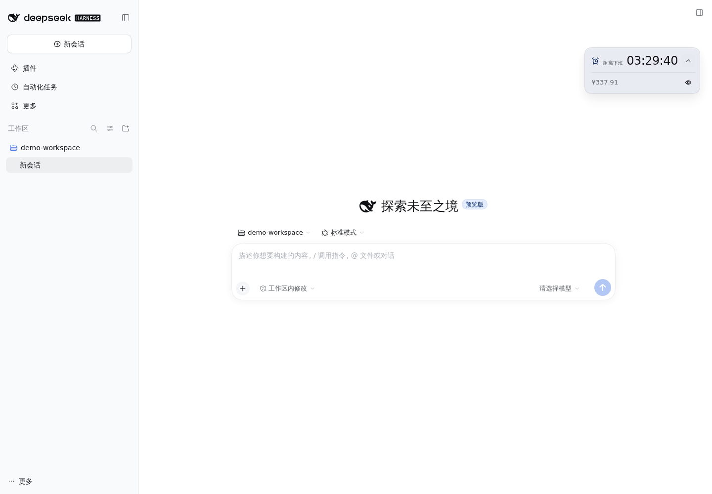
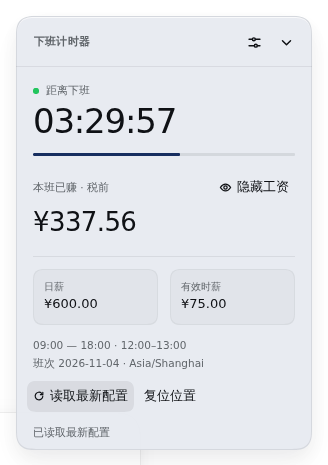
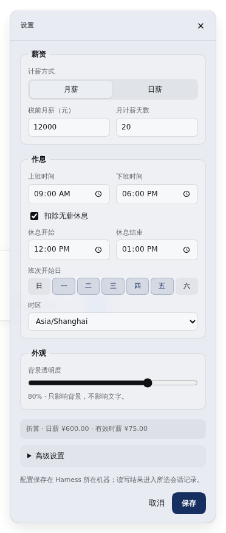

# 下班计时器 · Offwork Clock

> 此开发分支包含待验收的喝水提醒与拟人化角色“小歇”，尚未推送或发布。版本标记保持 `1.0.1`；计划在验收后再决定 `1.0.2` 的版本与发布操作。详见 [喝水提醒验收说明](docs/HYDRATION-ACCEPTANCE.md) 和 [拟人化表现层](docs/COMPANION.md)。npm 的现有版本不包含这些功能。

在 DeepSeek Harness 中查看距离下班还有多久，以及本班已经赚了多少钱。

`dsh-offwork` 提供可拖动的页面悬浮窗，支持月薪 / 日薪、跨午夜班次、无薪休息扣除和工资隐藏，工作时可以收起成小条。

[GitHub 仓库](https://github.com/SnowBeatRain/dsh-offwork) · [npm 包](https://www.npmjs.com/package/dsh-offwork) · [问题反馈](https://github.com/SnowBeatRain/dsh-offwork/issues) · [迭代路线图](https://github.com/SnowBeatRain/dsh-offwork/blob/main/ROADMAP.md)

## 功能

- **下班倒计时**：根据作息显示待开工、工作中、休息中、班次完成和休息日状态。
- **实时工资**：显示本班已赚金额、计薪进度、日薪和有效时薪，支持月薪或日薪输入。
- **灵活作息**：自定义上下班时间、工作日、时区，以及一段可选的无薪休息；支持跨午夜夜班。
- **悬浮小条**：拖动调整位置，按需展开详情；支持方向键微调和 Home 复位。
- **工资隐藏**：默认遮住金额，支持一键显示 / 隐藏；设置中的薪资输入和折算预览也会同步遮蔽。
- **外观与记忆**：背景透明度可在 30%–100% 之间调整，位置、展开状态和显示偏好可在刷新后恢复。
- **中文 / English**：提供中英文界面，并响应系统的减少动态效果设置。
- **代理工具**：可通过 Harness 命令或 `offwork_clock` 工具读取和更新配置。

## 效果预览

以下截图来自独立的 Harness 测试配置，使用示例月薪 12,000 元、月计薪 20 天及受控的浏览器时间。

**页面内的小条**



**展开详情与设置**

 

## 运行环境

- DeepSeek Harness：`>=0.2.1-rc.5 <0.3.0-0`。
- 使用 Harness 的 Web 界面，安装后刷新页面以加载客户端。

悬浮窗显示在 Harness 页面内，切换到其他应用后不会作为桌面置顶窗口显示。

## 安装

### 从 npm 安装

在 Harness 中使用 `plugin_manager` 的 `install_bundle` 操作，将 `target` 填为 `dsh-offwork`：

```text
plugin_manager → install_bundle → target: dsh-offwork
```

这是 Harness 插件，请通过 Harness 插件管理器安装，以加载 Host 配置和 Web 悬浮窗。使用命令行管理 Web 配置时，也可以运行：

```sh
dsh plugin --profile web add dsh-offwork
```

`web` 是配置名称，使用其他配置时请替换为实际名称。

### 从 GitHub 安装

```text
plugin_manager → install_bundle → target: github:SnowBeatRain/dsh-offwork
```

### 从本地源码安装

```sh
git clone https://github.com/SnowBeatRain/dsh-offwork.git
cd dsh-offwork
npm run build
```

随后在 Harness 中将 `target` 填为克隆目录的绝对路径：

```text
plugin_manager → install_bundle → target: /绝对路径/dsh-offwork
```

## 首次使用

1. 安装后刷新 Harness 页面，打开或创建一个会话。
2. 在首次设置引导中选择月薪或日薪，填写税前薪资；月薪模式还需填写月计薪天数。
3. 设置上下班时间、班次开始日和时区；如有无薪休息，启用扣除并填写休息时段。
4. 点击「保存」开始计时。引导中的初始数值仅为示例，保存前不会作为你的实际收入展示。

如需指定配置读写结果记入哪个会话，可在设置的「高级设置 → 操作记录会话」中选择。这个选择不影响工资计算。

### 常用操作

| 操作                   | 使用方式                                        |
| ---------------------- | ----------------------------------------------- |
| 移动悬浮窗             | 按住小条或卡片的空白处拖动                      |
| 微调位置               | 悬浮窗获得键盘焦点后，使用方向键调整；Home 复位 |
| 展开 / 收起            | 点击上箭头展开详情，点击下箭头收回小条          |
| 显示 / 隐藏工资        | 点击眼睛图标或「显示工资」                      |
| 修改薪资和作息         | 点击齿轮进入设置                                |
| 调整透明度             | 在设置中调整「背景透明度」，仅影响背景层        |
| 获取其他页面保存的配置 | 点击「读取最新配置」                            |

同一浏览器、同一站点下的多个标签页会同步显示偏好。薪资与作息配置由 Harness Host 共享，其他页面保存后可手动读取最新配置。

## 计薪规则

所有金额以人民币（CNY）显示，表示按配置估算的税前收入。

| 项目           | 计算方式                        |
| -------------- | ------------------------------- |
| 月薪模式的日薪 | 月薪 ÷ 月计薪天数               |
| 日薪模式的日薪 | 直接使用填写的日薪              |
| 有效时薪       | 日薪 ÷ 扣除无薪休息后的班次时长 |
| 本班已赚       | 日薪 × 已完成的有效计薪比例     |

例如，月薪为 10,000 元、月计薪天数为 21.75 天，上班时间为 09:00–18:00，并扣除 12:00–13:00 的无薪休息时，日薪约为 459.77 元，有效时薪约为 57.47 元。

- 金额按分截断，不四舍五入；计薪比例使用十进制有理数计算，减少浮点误差导致的丢分。
- 无薪休息期间收入暂停增长，下班倒计时继续。关闭「扣除无薪休息」即可按整段班次计薪。
- 下班时间早于上班时间时视为次日下班；工作日按**班次开始日**判断。例如周五 22:00–周六 06:00 的班次归属周五。
- 夜班完成后，上一班金额会保留到新一班开始。
- 时间使用配置中的时区，不依赖操作系统时区。夏令时按实际经过的秒数计算；重复的本地时间取较早一次，不存在的本地时间向后移动。

当前支持每班一段可选的无薪休息，不包含税费、加班费、法定节假日调班、多段休息或复杂轮班规则。显示金额用于个人参考。

## 数据与隐私

薪资和作息保存在**运行 Harness Host 的机器**上的插件目录 `data.json` 中。如果 Harness 部署在服务器上，配置也保存在该服务器上。保存时采用原子替换，文件权限为 `0600`；`data.json` 已被 Git 忽略，也不会包含在 npm 发布包中。

悬浮窗位置、展开状态、工资隐藏和透明度保存在浏览器本地存储。浏览器禁止存储时，这些偏好仅在本次页面访问期间有效。

**配置读取和保存通过 Harness 命令执行，返回的配置内容会进入所选会话记录；代理工具的调用及结果也会进入会话记录。** 工资隐藏只控制界面显示，不会清除配置文件或会话中已有的薪资信息。

## 命令与代理工具

在 Harness 会话中可使用以下命令：

```text
/offwork-clock get
/offwork-clock set {"monthlySalary":10000}
```

代理可调用 `offwork_clock` 工具。读取配置的参数为：

```json
{ "action": "get" }
```

更新配置时仅需传入要修改的字段，其他字段会保留：

```json
{
  "action": "set",
  "settings": {
    "payMode": "monthly",
    "monthlySalary": 10000,
    "workdaysPerMonth": 21.75,
    "start": "09:00",
    "end": "18:00",
    "breakStart": "12:00",
    "breakEnd": "13:00",
    "weekdays": [1, 2, 3, 4, 5],
    "timezone": "Asia/Shanghai"
  }
}
```

`weekdays` 使用 `0`–`6` 表示周日到周六；日薪模式使用 `"payMode": "daily"` 和 `dailySalary`。将 `breakStart` 与 `breakEnd` 设为相同时间可关闭休息扣除。

成功返回 `{ "ok": true, "settings": { ... }, "configured": true }`；尚未保存配置时，读取结果中的 `configured` 为 `false`。失败返回 `{ "ok": false, "error": "..." }`。界面、命令与工具共用配置校验和持久化逻辑。

## 开发

建议使用 Node.js 22，与仓库 CI 保持一致。运行时无第三方依赖；开发依赖用于格式检查和 IndexedDB 事务回归测试，通过锁文件固定版本。

```sh
git clone https://github.com/SnowBeatRain/dsh-offwork.git
cd dsh-offwork
npm ci --ignore-scripts
npm run format
npm run check
```

`npm run format` 统一源码格式并重新生成客户端；`npm run check` 检查格式、生成物一致性、自动化测试、JavaScript 语法及 npm 打包内容。单独构建使用 `npm run build`，单独运行测试使用 `npm test`。代码约定和人工验证步骤见 [贡献指南](https://github.com/SnowBeatRain/dsh-offwork/blob/main/CONTRIBUTING.md)。

| 文件               | 用途                                 |
| ------------------ | ------------------------------------ |
| `client.source.js` | Web 界面源码                         |
| `clock.js`         | 班次、时区和工资计算                 |
| `ui-utils.js`      | 界面状态与显示辅助函数               |
| `client.js`        | 构建生成的客户端文件，请通过构建更新 |
| `index.js`         | Host 命令、代理工具、配置校验与保存  |
| `tests/`           | 计算、持久化与界面辅助逻辑测试       |

`npm run build` 将计算模块和界面辅助模块内联到 `client.js`。`npm test` 先检查生成物是否与源码一致，再运行测试，覆盖班次边界、夜班、休息、时区与夏令时、金额精度、磁盘持久化和命令 / 工具行为。`1.0.1` 已在隔离的 Harness `0.2.1-rc.5` 与 Headless Chromium 中完成设置、拖动、刷新恢复及双标签页等浏览器验证，范围与限制见 [验证记录](https://github.com/SnowBeatRain/dsh-offwork/blob/main/docs/VALIDATION-1.0.1.md)。

## 发布到 npm（维护者）

包名为 `dsh-offwork`，版本以 `package.json` 为准。发布前确认 npm 账号拥有该包的发布权限，并完成检查：

```sh
npm ci --ignore-scripts
npm run build
npm run check
```

检查打包清单，确认包含 README、客户端、Host 入口和语言文件，且不包含 `data.json`、`.env` 或其他本地配置。

### 本地发布

```sh
npm login
npm publish --access public
```

`npm publish` 会通过 `prepublishOnly` 自动执行构建和完整检查。npm 不允许覆盖已发布的同名版本，后续发布需先更新版本，例如 `npm version patch` 或 `npm version minor`。

### GitHub Actions 发布

仓库已配置 [Test and publish 工作流](https://github.com/SnowBeatRain/dsh-offwork/blob/main/.github/workflows/publish.yml)：推送 `main` 或向 `main` 提交 PR 时运行检查；推送 `v*` 标签时，检查通过后发布到 npm。

1. 在 GitHub 仓库的 **Settings → Secrets and variables → Actions** 中配置 `NPM_TOKEN`，使用具备该包发布权限并满足 npm 发布认证要求的 npm 令牌。GitHub 登录使用的 `ghp_…` 令牌不能用于 npm 发布。
2. 确认代码已提交，且标签版本与 `package.json` 中的版本完全一致。
3. 通过 `npm version patch`、`npm version minor` 或 `npm version major` 创建版本提交和标签，再推送到 GitHub。例如发布修订版本：

```sh
npm version patch
git push origin main --follow-tags
```

在 [Actions 页面](https://github.com/SnowBeatRain/dsh-offwork/actions) 确认发布结果。本地发布和 Actions 发布任选一种，避免重复发布同一版本。

## 许可与反馈

本项目采用 [MIT License](https://github.com/SnowBeatRain/dsh-offwork/blob/main/LICENSE)。欢迎通过 [GitHub Issues](https://github.com/SnowBeatRain/dsh-offwork/issues) 反馈问题或建议；反馈时请说明 Harness 版本、浏览器和复现步骤，薪资信息可使用示例数值代替。
