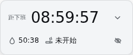
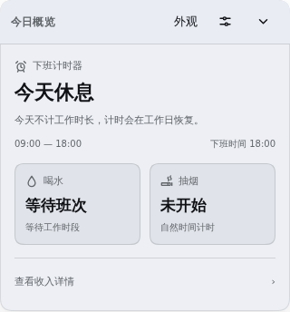
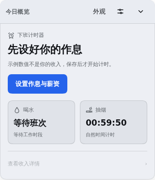

# 非宠物模式：小卡片与展开详情

这些交互已纳入1.1.2；发布状态见 [1.1.2发布记录](RELEASE-1.1.2.md)。

## 默认界面

关闭宠物模式后，默认显示实测224×94像素的悬浮小卡片：主状态与计时横向并排，下方一行水滴/香烟图标计时与收入眼睛入口。去掉内部灰块、分割线和单独收入行。点眼睛可显示金额，点金额可进入收入详情；超长金额可悬停查看完整值。详细说明、作息和大面板只在点击右上角“展开”后显示。设计过程见 [UI设计评审](UI-DESIGN-REVIEW.md)。

展开后的“今日概览”内容分为三层：

1. 班次状态与对应计时：开工前显示距离开工，工作中显示距离下班，午休显示距离午休结束；本班完成、休息日、读取中、未配置和缺少会话显示明确状态，不用00:00:00代替状态。
2. 喝水与抽烟各占一个入口，显示剩余时间或当前状态，点击进入各自独立卡片。
3. 收入置于底部，按原有隐私偏好显示或隐藏；点击进入收入详情。休息日、开工前和设置尚未就绪时不把零收入当作主要信息。

小卡片的右上角用于展开；右键可进入外观。展开后可进入外观、作息设置或收起为小卡片。原`mini`偏好继续控制展开/收起，位置、隐私和模式偏好继续保留。打开设置与其他卡片后可返回概览；未保存的编辑继续提供保存、放弃或继续编辑。

首次使用先给出“设置作息与薪资”入口，由用户打开配置。未选择会话时提示先打开会话；读取失败时提供重新读取。不会把示例薪资当作已配置的收入。

## 交互与边界

- 概览标题可拖动，方向键微调，Home复位；角色模式仍保持原有交互。
- 计时操作与数据存储沿用现有实现，抽烟不依赖薪资配置；没有会话时也可进入抽烟卡片。
- 只在用户导航后调整焦点，不因每秒计时变化移动输入焦点。
- 修正非宠物模式首次挂载时未绑定尺寸观察器的问题。长设置页随视口限制高度，可滚动到保存按钮；标题保留可见。
- 收起详情或关闭卡片不会停止抽烟计时，也不会给喝水打卡或延期。

## 验证

171项项目检查通过。新增纯展示状态检查，覆盖开工前、工作中、午休、本班结束、休息日、夜班与未就绪状态。

隔离Harness + Chromium验证：正常计时、收入隐藏、两项计时入口、返回概览、草稿保护、模式切换；320×568、390×844与640×360下的布局和长表单保存入口。通过模拟慢读取、读取失败、未配置与无会话，验证状态提示、重试和配置入口。宠物计时布局和原喝水提醒回归通过。

证据归档`offwork-hydration-artifacts/classic-overview`，脚本为`classic-test.cjs`与`classic-startup.cjs`；后者仅在隔离浏览器中注入读取故障场景。

## 界面截图

