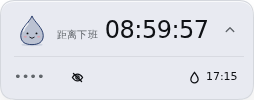
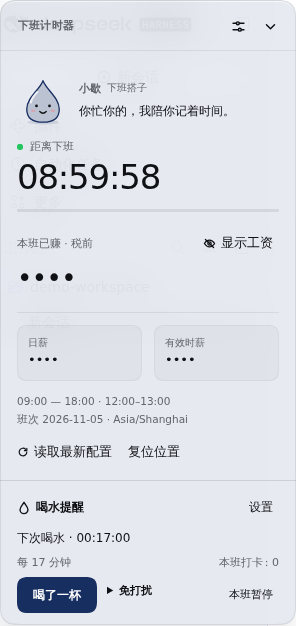
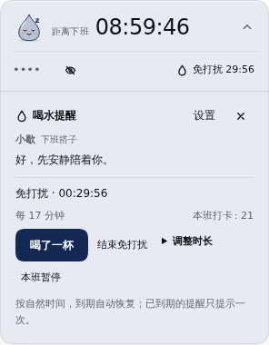
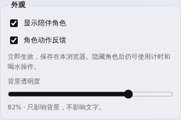

# 小歇：拟人化表现层与本地验收

状态：本地开发，待用户验收。保持产品版本 `1.0.1`，不推送、打标签或发布 npm。正式发布候选仍为 `1.0.2`。

用户将拟人化提升为当前优先事项，并询问是否需要整体重构。本轮重构角色、反馈与界面组织；现有计薪、喝水计时、IndexedDB 格式及多标签页租约继续复用。没有引入模型调用、外部角色资源或新的运行依赖。

## 本轮交付

- 原创 SVG 水滴角色，暂名“小歇”，定位为轻量的下班搭子。
- 小条左侧显示角色，点击角色可打开现有喝水快捷区；喝水倒计时入口保留。
- 展开面板展示角色和一句状态文案。快捷区不重复绘制头像。
- 喝水成功后短暂微笑与轻微动作，并反馈“这杯记下啦”。反馈到期回到当前状态；切换界面不重播同一次反应。
- 免打扰、本班暂停、午休、班前、休息日保持静止；下班状态优先于此前的本班暂停。
- 只有持有有效提示租约的标签页进入喝水提醒姿态；角色不另建提醒或增加提示。
- 外观设置提供“显示陪伴角色”和“角色动作反馈”。立即生效，只保存在当前浏览器；旧位置、透明度、工资隐藏偏好继续保留。
- 隐藏角色后，原有倒计时、喝水快捷操作和记录仍可使用。系统减少动态效果设置会禁用角色动画。

## 结构

1. `clock.js`、`hydration.js`、`hydration-store.js` 保持业务事实来源，本轮未修改。
2. 客户端事务控制器返回 `{ state, recorded, quietChanged }`，把实际成功的操作与无效/重复操作区分开。
3. 新增 `companion.js`：纯状态映射、原创角色渲染、中英文文案和样式。输入只有工作状态、提醒状态、显示权和操作反馈，不读取工资、会话或个人备注。
4. `client.source.js` 组织视图和操作，把反馈映射为角色表现。角色本身没有计时器，也不读写持久化。
5. 固定的单一反馈播报区域保留在各视图之外，切换小条、快捷区和展开面板时不重新创建同一反馈。角色 SVG 为装饰元素，含义由文字与按钮提供。
6. `ui-utils.js` 为浏览器外观偏好增加默认值；`tools/build.mjs` 内联角色模块，继续生成 `client.js`。

为保证界面可用，同时处理了默认位置下长设置页超出视口、快捷区收起导致内部按钮移位、结束免打扰/确认清零后焦点丢失，以及展开状态下重复展示到期文案的问题。

## 状态示例

| 状态           | 角色与文案                             |
| -------------- | -------------------------------------- |
| 工作中         | 平静陪伴：“你忙你的，我陪你记着时间。” |
| 喝水已成功记录 | 短暂微笑：“这杯记下啦。”               |
| 免打扰         | 闭眼静止：“好，先安静陪着你。”         |
| 本班暂停       | 静止：“本班先不提醒，需要时再叫我。”   |
| 午休           | 放松：“休息一下，回来再继续。”         |
| 本班结束       | 静态微笑：“这一班结束啦，辛苦了。”     |
| 存储不可用     | 中性状态，提示重试，不显示打卡成功     |

不根据用户停留时长推断心情，不用催促、责备或连续弹跳吸引注意。

## 效果截图

来自隔离 Harness 的示例配置，工资保持隐藏。

## 验证

- `npm run check`：110 项测试通过，包含 5 项新表现层与偏好兼容测试；构建一致性、格式、语法及 npm 打包清单检查通过。
- 隔离 Harness `0.2.1-rc.5`，Headless Chromium `156.0.8078.4`：角色入口、确认打卡、有限动作、计时刷新不重播、免打扰静止、系统减少动态效果、隐藏角色与刷新持久化、两项偏好独立以及跨标签页同步。
- 两标签页同时到期时只有一个提示和一个喝水姿态；到期确认和主动打卡均有真实成功反馈。
- 切换视图时保持同一播报节点，动作不重播；设置页可滚动到末尾；320px 窄屏无横向溢出。
- 继续验证 Host 作息 A→B→A 的授权与同步，以及结束免打扰、确认清零后的键盘焦点。
- 午休、本班暂停、下班状态与现有业务状态一致。
- 角色形象和语气仍需用户实际体验；本轮未开展 Safari/Firefox 的独立兼容验收。

## 后续

先验收“小歇”的形象、占用空间与语气，再调整表情、动作或角色风格。远眺与心情以后提供新的明确状态给该表现层；记录和提醒仍由对应业务模块负责。
