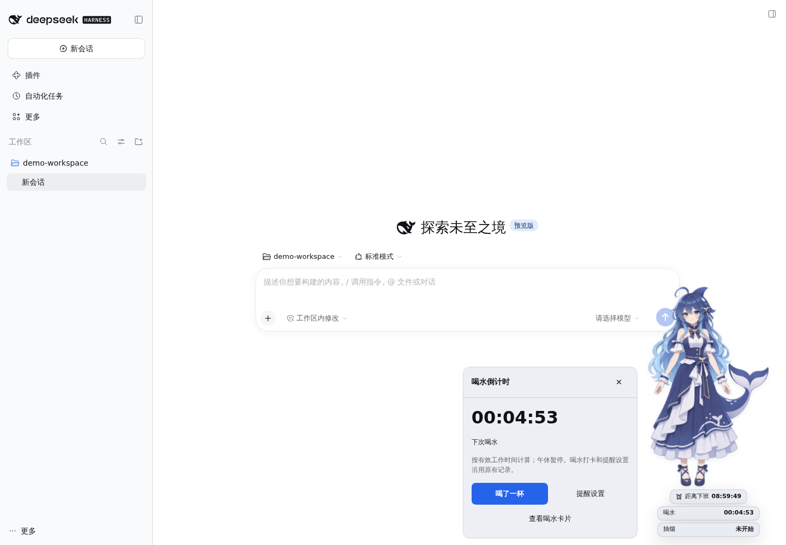
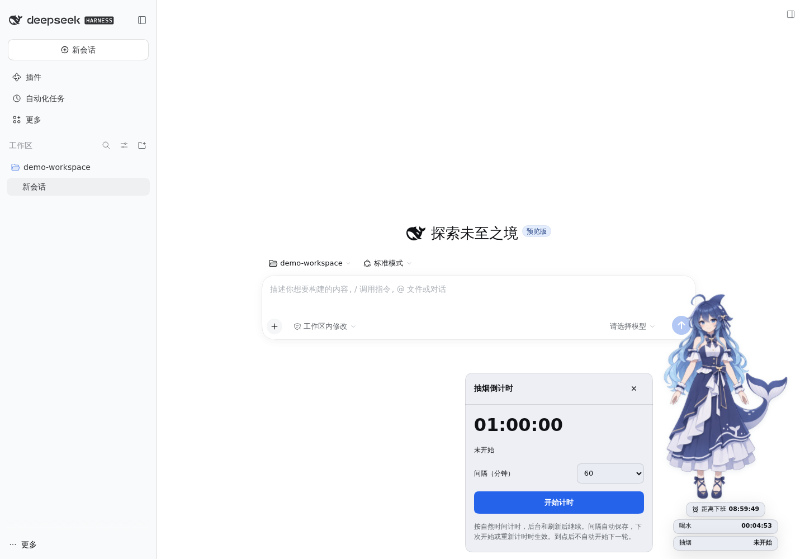
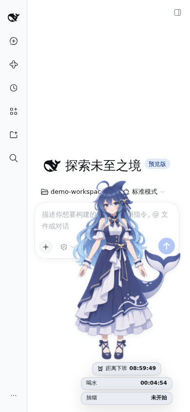

# 独立喝水与抽烟倒计时（开发预览）

角色下方现在分三行显示下班、喝水和抽烟时间。两项新增倒计时都有独立的右键菜单入口与卡片，收起卡片后仍可查看剩余时间。版本暂保持1.1.1，未另发npm版本。

## 喝水倒计时

右键 → 喝水倒计时，可查看大字计时、打卡或进入原有提醒设置。原“喝水”卡片继续提供次数、免打扰和本班暂停等操作。

计时直接来自已有喝水记录，不创建第二套提醒。沿用有效工作时间、午休冻结、班次暂停和免打扰规则；免打扰时显示恢复提醒前的剩余时间并标注状态。尚未启用、等待班次或数据不可用时显示对应状态。打卡成功只增加一次记录并重置原提醒周期。

角色左键仍只互动；新增计时行仅显示信息，卡片由右键菜单或键盘菜单打开。原到期提醒及其快捷入口保持有效。

## 抽烟倒计时

右键 → 抽烟倒计时。默认间隔60分钟，手动开始；可选1、5、10、15、20、30、45、60、90、120、180、240、480、720或1440分钟。

- 使用自然时间，与作息、工资和喝水提醒独立；后台或刷新后继续按原截止时间显示。
- 暂停保留剩余时间，继续从暂停处恢复；重新计时才使用完整的所选间隔。
- 修改间隔立即保存，但不会改变正在进行或已暂停的一轮。
- 到期显示00:00:00和“已到时”，不自动开始下一轮、不自动弹卡，也不触发喝茶动作。
- 停止回到未开始状态。页面卡片关闭不会停止计时。
- 多标签页共享状态；事务校验版本，过时操作会刷新显示并提示重新操作。
- 存储异常时禁用修改并提供重试，不用默认值覆盖原计时。重试恢复已有截止时间；主动清除站点计时数据库后也会清除页面上的旧计时显示。

## 数据与实现

新增`countdown.js`承载纯状态校验、计时视图和状态转换。`hydration-store.js`提取通用的`createStateStore`事务层，喝水入口保留原数据库、校验器和迁移逻辑。

抽烟数据独立保存在浏览器IndexedDB `dsh.offwork-clock.smoking.v1`，仅包含间隔、状态、截止时间、暂停余量和版本；不写入Host薪资文件或会话。BroadcastChannel与轮询仅用于同步显示，写入仍通过IndexedDB串行事务。清除浏览器站点数据会清除这些本地计时数据。

宠物布局为三行计时预留空间，并按可视高度缩放角色；临时屏幕尺寸变化不改写用户保存的位置。

## 示例截图

## 验证

168项项目检查通过，覆盖自然时间到期、暂停/恢复、改间隔、显式重启、异常数据拒绝、跨标签事务、喝水数据隔离、草稿保护和窄屏布局。

独立Harness浏览器验证通过：

- 两项独立卡片、喝水设置返回目标、打卡后计时更新。
- 抽烟暂停/恢复/到期、刷新后恢复原截止时间及暂停余量、跨标签同步。
- 抽烟操作不改喝水次数、截止时间或已接受的打卡动作。
- 存储故障后的恢复与清除数据库后的旧状态清理。
- 作息配置读取失败时仍能使用抽烟计时。
- 最大角色尺寸下的320×568、390×844、640×360边界与按钮可达性。
- 原定时提醒、到期刷新策略、草稿保护、双标签去重、视频试播和按需加载回归。

测试脚本和结果归档在`offwork-hydration-artifacts/countdown-preview`。实际Safari、Firefox和移动设备尚未单独验收。
