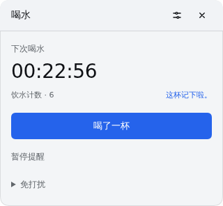
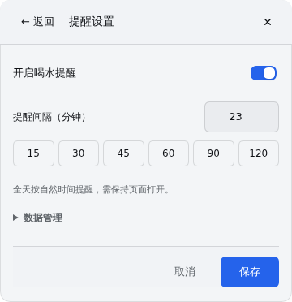
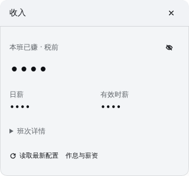
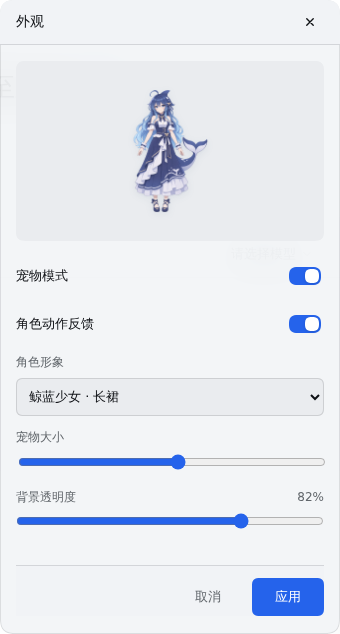
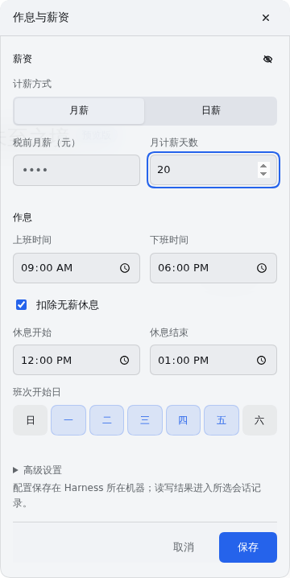

# 详情页简化设计

本轮只调整展开后的功能页，默认224×94非宠物小卡片继续保留。发布仍暂停，当前为1.1.1开发预览。

以实际页面截图进行独立AI设计评审，再对六张完成后的实际截图复审。目标是减少嵌套灰框、重复说明和同等权重的按钮，让常用操作直接可见，低频内容按需展开。

## 页面变化

- **喝水**：倒计时与饮水计数置顶，“喝了一杯”为主操作；提醒设置移到标题栏，暂停/恢复直接可用，免打扰展开后选择30分钟或1小时。成功反馈放在计数旁，移除常驻空泛文案。
- **提醒设置**：启用开关、分钟输入和一行常用间隔；只保留一句全天提醒说明。草稿变化时显示已生效间隔及保存提示，避免把未保存值误当成当前设置。数据管理折叠，保存放在底部；非法输入会定位到间隔字段。
- **喝水倒计时**：复用主数字和计数，保留打卡与喝水卡片入口；设置同样在标题栏。
- **抽烟计时**：状态切换的主按钮保持同一位置，重新计时和停止为次要操作；长说明放进“使用说明”，保留“间隔用于下一轮”的提示。
- **下班与收入**：减少数字字重，次级收入指标去框，班次/时区信息折叠。下班或休息日显示状态；午休时独立下班页仍显示距下班的时间，不改计时目标。
- **外观**：缩小预览占高，开关改为整行控件，滑杆铺满可用宽度，透明度数值就近显示；应用和取消语义不变。最大尺寸的视频与海报保持对齐、不截断。
- **作息与薪资**：去除大字段集灰框，保留薪资、工作时间、休息与工作日。薪资显隐入口放在组标题；时区和会话选择放进高级设置。隐藏薪资时不展示无意义的遮罩折算行，保存前的隐私说明仍保留。

短卡宽度统一接近320px；提醒设置与薪资配置360px，外观340px。详情页统一标题、输入、按钮和底部操作栏，使用主题颜色；小屏保留滚动、键盘访问和可到达的保存入口。切页从顶部开始，未保存修改仍需要保存、放弃或继续编辑。

## 验证

- 完整项目检查通过，未改变自然时间提醒、存储、计薪、隐私和多标签页事务规则。
- 浏览器验证：打卡、免打扰、暂停/恢复、自定义间隔与错误定位、返回草稿、计数清零与未保存间隔隔离；抽烟开始/暂停/继续/停止；收入显隐与折叠详情；薪资作息保存。
- 七个页面及提醒设置在320×568、390×844和640×360中无横向溢出，保存按钮可滚动到达。
- 最大角色预览、真实视频试播、取消和草稿确认后的恢复通过；默认小卡片、宠物交互与提醒规则继续保留。
- 所有截图来自隔离环境的示例配置，金额默认隐藏。

独立AI复审仅从截图判断未发现必须修正的拥挤、对齐或层级问题。浏览器脚本及评审原文归档在`offwork-hydration-artifacts/detail-pages`。

## 当前界面

