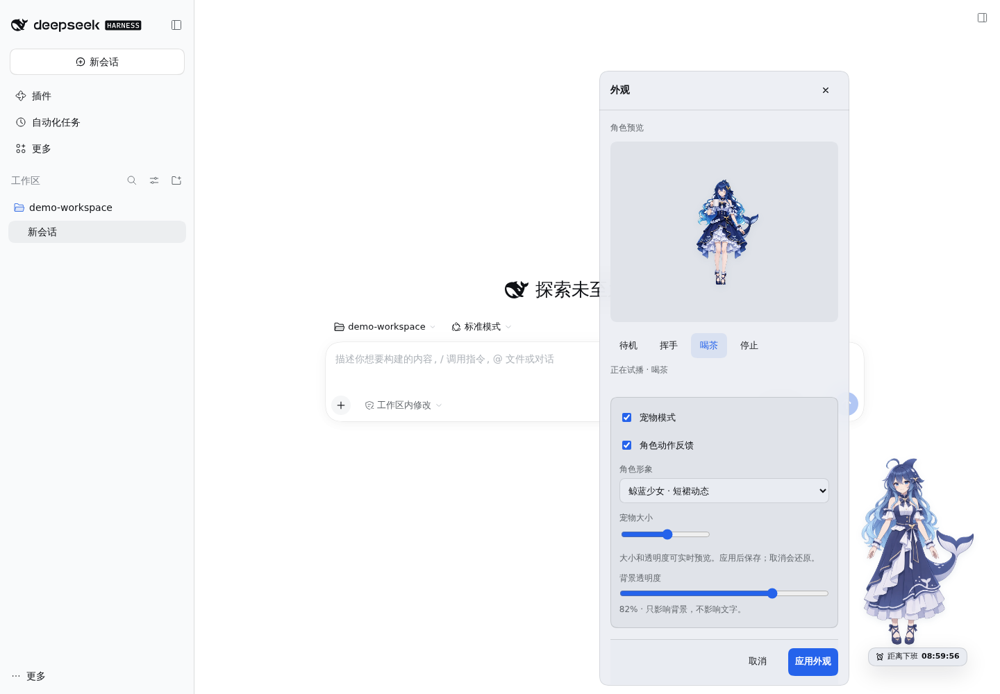
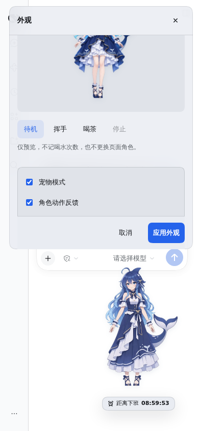

# 陪伴角色体验优化

1.1.2在1.1.1基线上加入外观动作试播、按需视频加载和更平稳的动作衔接。发布状态见 [1.1.2发布记录](RELEASE-1.1.2.md)。

## 动作试播

右键角色 → 外观，选择动态形象后，可试播其已有的待机、挥手或喝茶动作，并随时停止。长裙没有独立待机视频，因此只提供挥手和喝茶。

- 试播使用独立播放器，不调用喝水操作，不改变次数、提醒计划或已保存外观。
- 切换下拉框只改变预览，应用后才更换页面角色；取消丢弃草稿。
- 进入预览时不自动下载或播放视频，点击对应动作才开始读取该片段。
- 切换形象、取消、进入未保存确认框或页面隐藏时停止试播；继续编辑后不重播旧动作。
- 动作开关和系统减少动态效果都会生效；播放失败恢复静态图并给出可重试提示。
- 试播区不依赖已记录的喝水或当前班次，可在会话尚未准备好时查看形象动作。

## 资源加载

静态图和小型透明度探测片保留在客户端；五段人物视频改为从Harness Host的同源资源地址按需读取。

- 客户端脚本从约10.7MB降至约0.84MB，缩小约92%；候选安装包约8MiB，原1.1.1安装包约15MiB。
- 选择静态角色不请求人物视频；外观草稿选择动态角色也不下载，只有试播或页面实际播放才读取对应片段。
- 视频URL包含内容SHA-256，支持不可变缓存、ETag、GET/HEAD和单段Range。浏览器验证中，重复试播复用了缓存，没有重新传输整段视频。
- `media-manifest.js`与`client.js`都由`tools/build.mjs`生成。修改视频后须重新构建，不手工修改生成文件。
- Host通过可选的webServer作用域注册`/offwork-clock/media`。路由只允许生成清单里的文件，校验大小与内容，不接受目录遍历或任意文件路径；不会提供薪资文件、会话或环境配置。
- 非Web环境缺少资源路由时，命令/工具仍可用，角色保留静态回退。没有新增运行时依赖或外部文件站请求。

## 动作衔接

新片段加载期间保留当前画面，准备好后再交接；旧视频随后暂停并释放。快速切换会取消过时请求，最多保留当前画面与正在接入的片段，不积累播放队列。

透明画面采用隔离的加法混合处理淡入淡出，减少切换过程中短暂变淡。明确停止、关闭动作和后台暂停会立即回到静态图。已有素材中的裁切、缺失部位和抠像边缘没有重新绘制。

## 预览截图

截图来自独立测试环境，使用示例配置。

## 验证

- 163项项目检查通过，包括资源白名单、完整性、Range/HEAD/ETag、非法路径、符号链接、失败重试、播放器清理、预览取消与旧回调隔离。
- 独立Harness + Chromium验证：静态启动零视频请求、草稿选择零视频请求、单动作按需读取、缓存复用、真实透明度、等待新片段时保留旧画面、失败重试。
- 对照浏览器记录与偏好，试播不增加打卡、不重排提醒、不保存角色；真实打卡才增加一次并播放喝茶，结束恢复待机。
- 验证加载中换模型、键盘试播、未保存确认后的继续编辑、后台停止、动作开关与系统减少动态。
- 320×568、640×360、390×844下最大尺寸预览保持完整，海报和视频对齐，保存入口可滚动到达。
- 保留并回归最新定时提醒行为：到点弹出、不抢输入焦点、收起不延期、不重复记录、刷新逾期只提示、编辑不打断、双标签只显示一个提醒。

独立验证目录为`/tmp/offwork-experience-preview`，不共用其他正在进行的提醒修复测试服务。真实Safari、Firefox及移动设备未单独验收。
