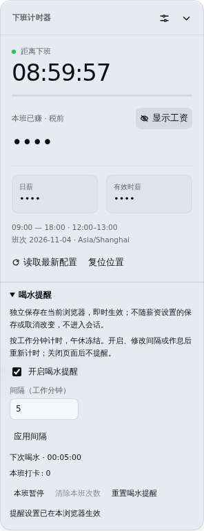
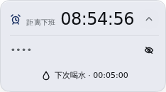
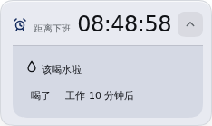
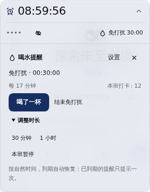
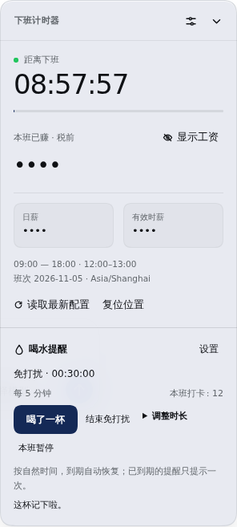

# 喝水提醒：本地验收说明

状态：本地开发，待用户验收，`dsh.toolscc.cn` 测试账号按用户要求加载开发目录。尚未推送、合并到主分支、打标签或发布 npm。当前 package.json、锁文件和客户端版本标记仍为 `1.0.1`；候选发布版本为 `1.0.2`，验收后再处理。

开发目录：`/opt/dsh/users/xxy/workspace/dsh/offwork-hydration-dev`。

本地分支：`feature/hydration-reminders`。

开发版默认使用独立宠物入口：左键进入日常主页，右键打开菜单；主页可打卡、免打扰，并进入“下班与收入”、提醒、外观或薪资设置。最新导航、保存与关闭规则见 [交互重构说明](PET-PREVIEW.md)。关闭宠物模式后仍可使用下述卡片入口。

## 功能入口与规则

1. 点击小条里的水滴/喝水倒计时，直接打开快捷操作区，可“喝了一杯”、免打扰或进入设置，无需展开工资详情。设置保存/取消后返回快捷区；再次点击倒计时、关闭按钮、外部区域或按 Escape 可收起。完整展开面板也保留喝水卡片及设置入口。
2. 默认关闭，默认间隔 60 分钟。选择 15 / 30 / 45 / 60 / 90 / 120 分钟预设，或输入 5–240 的整数，然后统一点击“保存提醒设置”。支持回车保存；取消和返回均不保存草稿。
3. 保存后回到原面板，明确显示已生效的间隔和下次提醒；小条第一行显示下班时间，第二行显示工资与喝水状态。喝水倒计时逐秒显示 `05:00 → 04:59`，不足一小时用分秒，一小时以上保留时分秒。
4. 到期时只显示一处提示，提供“喝了”“工作 10 分钟后”。“本班暂停 / 恢复”在展开面板中操作。提示不自动获取键盘焦点。
5. 到期前也可在展开面板点击“喝了一杯”，记录本班次数并重排提醒。关闭提醒或本班暂停时可打卡，只记次数，不恢复提醒；午休打卡后复工仍有完整间隔。暂停通过展开面板中的“恢复本班提醒”解除。
6. 午休冻结倒计时；夜班按班次开始日归属；非工作日和下班后不弹提醒。
7. 开启、修改间隔、修改作息或恢复本班时重新安排完整周期。修改工资金额本身不改变提醒。
8. “清除本班次数”仅清零次数；“重置喝水提醒”恢复默认关闭。两者均需要确认。
9. 展开面板的“免打扰”可选 30 分钟或 1 小时，按自然时间倒计时；可调整时长或提前结束。到期仍在工作且已有逾期提醒时只提示一次，午休和下班不提示。打卡不会结束免打扰；本班暂停或关闭提醒会清除它。
10. 操作反馈几秒后自动消失。菜单收起后保留键盘焦点，挂载和自动提醒不会抢焦点。

提醒数据保存在当前浏览器的独立 IndexedDB 中，不写入服务器工资文件或 Harness 会话。关闭页面后不提醒。同源标签页共享数据；只由领取显示权的可见页面显示到期提示，关闭后允许其他页面接管。

若另一标签页更新了作息，旧页面不会覆盖新计划，会提示“读取最新配置”。存储不可用时停止自动提醒，不影响工资功能；可重试或明确重置。浏览器不支持 BroadcastChannel 时，正常数据通过轮询同步；存储错误后的跨页重置恢复可能需要在该页点击“重试读取”。

## 拟人化表现

开发版已加入原创角色“小歇”。角色复用这里的计时与事务结果，支持隐藏和关闭动作；详细说明见 [拟人化验收](COMPANION.md)。

## 效果截图

以下图片由真实的隔离 Harness 页面采集，使用示例数据与受控浏览器时间，工资保持隐藏。

### 提醒设置



### 小条倒计时



### 到期提示



### 倒计时快捷入口



### 手动打卡与临时免打扰




## 本地启动预览

在服务器终端中执行以下命令；它创建独立的临时 Harness 配置，不替换现有安装：

```sh
cd /opt/dsh/users/xxy/workspace/dsh/offwork-hydration-dev
npm ci --ignore-scripts
npm run build
preview_dir=$(mktemp -d /tmp/offwork-hydration-acceptance.XXXXXX)
npm pack --ignore-scripts --pack-destination "$preview_dir"
DSH_HOME="$preview_dir/home" dsh plugin --profile web add "$preview_dir/dsh-offwork-1.0.1.tgz" --ignore-scripts
DSH_HOME="$preview_dir/home" dsh web --host 127.0.0.1 --port 3081 --no-open
```

浏览器打开该进程在终端输出的地址。若通过 SSH 使用服务器，可把服务器 `3081` 端口转发到本机同端口，再打开该地址。启动地址含临时授权信息，不要公开分享。若端口已占用，请更换空闲端口。

首次进入选择一个测试工作区，创建空会话，使用示例薪资完成作息配置。不需要配置模型 API 或发送模型请求。打包文件沿用 `1.0.1` 仅因为本轮保持版本不变，它是本地候选文件，不是 npm 公共版本。

## 建议验收顺序

- 检查默认关闭，启用后设置 5 分钟，等待一次真实提醒。
- 点击“喝了”，确认次数变为 1，倒计时重新开始。
- 刷新页面，确认间隔、次数及计时保留。
- 下一次提醒点“工作 10 分钟后”，确认不增加次数；测试本班暂停和恢复。
- 打开第二个相同地址的标签页，确认到期只显示一条，且打卡只记一次。
- 检查清零与重置前的确认提示，并确认工资设置、金额隐藏及位置不受影响。
- 体验窄窗口、拖动和键盘操作，反馈文案或布局是否需要调整。

只需反馈“哪些通过、哪些需要改”，不需要操作版本标签或 npm 发布。

## 验证记录

- 环境：Linux ARM64、Harness `0.2.1-rc.5`、Playwright 驱动的 Headless Chromium `156.0.8078.4`。
- 自动化：119 项测试，含既有业务/表现回归和新增 6 项导航、草稿、菜单与外观快照检查。
- 本轮浏览器专项：关闭提醒/本班暂停时打卡、正常重排、双击防重、免打扰中的打卡、时长替换、自然时间到期、提前结束、跨标签页单提示、午休、下班和新班次。
- 快捷入口浏览器专项：小条点击后直接打卡/免打扰，设置保存与取消返回快捷区，键盘焦点恢复、Escape/再次点击/外部点击收起，320px 视口，以及到期提示与快捷打卡共享计数。
- 本轮兼容性专项：旧 schema 1 的设置/次数/暂停/到期进度保留；旧表单只提交用户改过的字段；挂载和自动提示不抢焦点；未知 schema/存储不可用时禁用动作，恢复访问后重试可用。
- 间隔专项浏览器回归：逐一验证 5、15、17、30、45、60、90、120、240 分钟的输入/选择、持久化值、倒计时与实际到期；另验证 23 分钟回车保存与刷新恢复。
- 交互专项：取消不保存、非法输入不会覆盖已保存值、薪资/提醒表单分离、另一标签页更新不覆盖正在编辑的草稿、窄屏布局。
- 倒计时显示回归：自然等待后小条 `05:00 → 04:58`，与展开面板一致；刷新后继续到 `04:56`，持久化到期进度不变，到期仅出现一条提醒。旧版把小条取整显示为“5 分钟”，首分钟视觉上不变，已改为逐秒显示。
- 原生 IndexedDB：在两个真实浏览器页面中验证并发领取、重复打卡、事务重置、未知 schema 拒绝及暂时打开失败后的重试。
- Harness 界面：默认关闭、间隔校验、开启、提示不抢焦点、打卡、稍后、暂停、恢复、确认清零、刷新持久化、窄窗口均通过。
- 多标签页：单一提示、关闭持有者后接管、损坏数据停止提醒，以及明确重置后两个标签页恢复均通过。
- 作息：真实界面验证了午休冻结、复工继续、旧标签页不能通过隐藏事件覆盖新作息，以及 A→B→A 变更后旧授权不被重复使用。
- 存储拒绝：自动提醒停止，工资界面仍正常；恢复访问并点击“重试读取”后恢复。
- 构建、格式、语法及包清单检查通过。Host 入口、工资持久化和计薪引擎未修改。

浏览器时钟由测试控制以覆盖较长间隔。以上不等同于完成 Safari、Firefox、移动端触摸和真实长时间休眠的人工验收。暂停的浏览器进程无法实时重绘旧画面，恢复时会重新校验显示权；本功能不承诺关闭页面后的后台通知。

## 间隔设置交互修复

已在隔离 Harness 复现旧版问题：用户输入 15 分钟后点击薪资“保存”，提醒实际仍为 60 分钟。原实现需要另外点击“应用间隔”，造成保存入口混淆。计时引擎没有限制只能使用一小时。

本轮用独立提醒表单解决：常用间隔、自定义输入和启用开关统一保存，取消不生效；后台或其他标签页更新不能改写未保存草稿。原有浏览器提醒数据保持兼容，不重置个人设置。

## 子 agent 调研与复审

开发前分别完成业务、浏览器协调和接入测试三份调研，原始结论保存在 `docs/hydration-research/`。具体取舍见 [开发约定](HYDRATION.md)。

实现后再次交由独立子 agent 复审，修复了：

- 旧作息标签页通过 release 等动作回写旧计划：所有动作统一执行作息变更条件检查。
- 存储打开失败无法重试：失败后清理打开状态，允许重新建立连接。
- 重置后没有通知错误态标签页：重置无条件广播。
- 重置导致修订号倒退：从实际记录继承并递增修订号。
- 作息变更授权被重复使用：成功应用后消费该授权，并以 A→B→A 双标签场景回归。
- 启动时读取顺序造成授权缺失：读取/保存 Host 作息前先读取提醒事务状态。

本轮手动打卡与免打扰另做两份独立调研和一次实现复审，修复了：并发操作过早解除客户端调度门闩、旧表单覆盖另一页未编辑的字段、重复恢复本班重排计时、初始挂载抢焦点、免打扰菜单收起后的焦点丢失，以及修订号溢出时写入无效数据。

所有改动仅保存在本地开发工作树。用户确认验收结果后，再单独决定合并、修改版本、推送和发布。
