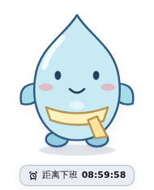
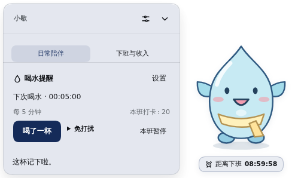
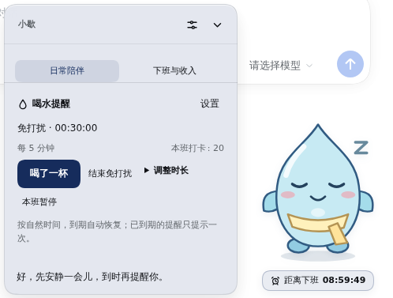
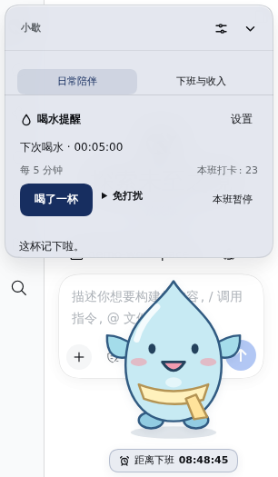
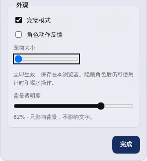

# 独立 Harness 宠物原型

状态：本地开发预览，待用户体验。保持 `dsh-offwork@1.0.1`，不推送、不发布 npm。仅在用户指定的 `dsh.toolscc.cn` 开发环境加载。

## 这一版是什么

我们自己的独立页面宠物，代码、矢量角色和交互均由本项目实现。未修改或复制已安装的 dsh-pet / dsh-pet-offwork，不依赖它们的服务或素材。角色只在 DeepSeek Harness 页面内显示。

“小歇”以带围巾的原创水滴全身形象独立悬浮，角色背后没有计时卡片。脚下是一条下班倒计时；点击角色或倒计时打开旁边的面板。

- “日常陪伴”：喝了一杯、免打扰、本班暂停、提醒设置与状态反馈。
- “下班与收入”：完整班次倒计时、收入和作息信息，工资默认继续隐藏。
- 拖动安置宠物，刷新保留位置；聚焦宠物后用方向键微调，Home 复位，Enter 打开，Escape 收起。
- 面板顶部有明确的“外观”按钮，直接打开独立外观页；第一项为“宠物模式”，下面可调大小、动作反馈及背景透明度，点击“完成”返回。原计时卡片和喝水快捷区也提供入口。关闭宠物模式返回计时卡片，记录和设置保留。
- 提醒到期时，在宠物旁展示一条操作气泡；打卡成功有短暂动作与反馈。午休、暂停、免打扰、跨班次继续使用现有业务规则。
- 面板在空间足够时显示在宠物侧面，窄屏上下排列；极短视口使用可滚动覆盖面板。

本轮提供的是原创 SVG 角色原型。尚未开放第三方模型包导入、Live2D 或视频/序列帧渲染，不把这些作为已完成功能。

## 结构与数据

- `pet-view.js`：独立的原始模型描述、原创全身 SVG、浮层位置计算、页面宠物样式与中英文标签。
- `companion.js`：从真实业务状态与确认过的操作派生表情和反馈。
- `client.source.js`：页面宠物舞台、可滚动面板、拖动、焦点和现有功能入口。
- `clock.js`、`hydration.js`、`hydration-store.js` 保持原有业务与存储规则。
- 浏览器视图记录增加 `petPosition` 与 `petSize`，与原计时卡片位置分开保存；旧工资隐藏、透明度和动作开关保留。

## 示例截图

截图来自隔离 Harness，使用示例数据。

## 验证

- 113 项自动化测试通过，包括原有业务回归、角色表现及偏好迁移，以及新增的浮层边界/方向选择/尺寸约束测试。
- 隔离 Harness + Chromium：独立舞台、点击开关、打卡与反馈、拖动不误触、位置刷新恢复、方向键移动、工资隐藏、大小调整、免打扰、到期气泡、双标签页单提示、宠物模式切换及数据保留。
- 外观入口专项：宠物面板、计时卡片和喝水快捷区可直接进入独立外观页；切换模式时保持焦点，大小设置刷新保留；不改变喝水间隔、次数或到期进度，薪资表单保持独立。
- 320px 窄屏中的面板可滚动且无横向溢出；系统减少动态效果设置生效。几何测试还覆盖短视口和越界位置。
- 一次独立代码复审，修复模式切换时焦点丢失、短视口尺寸限制、取消拖动后残留点击抑制。另修复手动打卡时按钮禁用造成的焦点丢失。
- 复审中的“不同会话各有工资配置”不符合本项目实现：Host 使用单一配置文件，会话选择仅用于操作记录。没有据此改变会话/配置语义。
- 不将无动作的通知当成应播放动画的反馈；喝水成功反应继续使用事务修订号，普通通知保持静止。

首次预览重点体验角色大小、悬浮位置、日常面板和交互手感。跨浏览器及真实触摸设备仍需后续验收。
