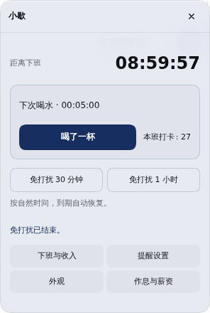
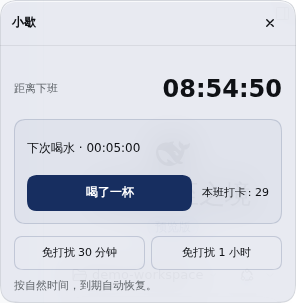

# 独立 Harness 宠物：交互重构验收

状态：本地开发，待用户体验。产品版本保持 `1.0.1`，不推送、不发布 npm；只更新 `dsh.toolscc.cn` 指定开发环境。角色、界面、交互代码均由本项目实现，没有依赖或修改其他宠物插件。

## 统一操作规则

| 操作                      | 行为                                                                |
| ------------------------- | ------------------------------------------------------------------- |
| 左键点击宠物或脚下倒计时  | 总是打开日常主页；已经打开时回主页                                  |
| 右键 / Shift+F10 / 菜单键 | 打开小菜单，选择外观、提醒设置、作息与薪资、本班暂停/恢复、复位位置 |
| 拖动宠物                  | 仅移动位置，松开后保存，不触发点击；方向键微调，Home 复位           |
| 页面标题栏“返回”          | 返回上一级；不等同于关闭                                            |
| 页面标题栏“关闭面板”      | 收起整个面板                                                        |
| Escape                    | 先关菜单，再处理当前页；编辑中有未保存修改时询问处理方式            |
| 点击外部                  | 关闭菜单；普通面板收起。编辑中的表单保持原位                        |

右键使用自定义菜单，不直接跳进完整表单。菜单优先避开宠物，支持方向键和 Home/End 选择、Enter 执行、Escape 返回。组件内非文本输入区域的右键先拦截原生菜单；文本编辑与 Harness 其余区域保留原有菜单。

## 日常主页

- 下班倒计时、喝水剩余时间和本班次数集中展示。
- “喝了一杯”为主要按钮；免打扰 30 分钟 / 1 小时均可一次点击完成。
- 免打扰中显示剩余自然时间和结束入口；本班暂停后直接提供恢复入口。
- 下方四个入口：下班与收入、提醒设置、外观、作息与薪资。
- 打卡反馈放在预留区域，不改变主要按钮的位置。关闭面板后的反馈使用短提示，不再撑开一整块面板。
- 普通面板采用固定边界和可滚动内容，标题栏始终可见；页面切换和反馈更新不会改变面板位置。预览宠物大小时固定面板，应用后按新尺寸重新定位。
- 到期提醒沿用原租约，只由一个标签页显示。关闭到期气泡会执行“工作 10 分钟后”，不会刚关掉又出现。

## 设置、草稿与保存

- 提醒和薪资设置使用各自的保存按钮。
- 外观先预览，点击“应用外观”才保存；取消还原。宠物模式切换也在应用后发生，编辑时不切换整个界面。
- 插件内部返回、关闭、Escape、左键回主页或右键选择其他页时，若存在未保存修改，显示“保存并继续 / 放弃修改 / 继续编辑”。
- 保存失败保留表单和值，并显示错误；重试成功后才进入目标页面。
- 同一页面再次打开不会重置草稿。跨标签页更新不覆盖当前草稿，外观保存只提交实际改过的字段。
- 收入默认隐藏；作息与薪资保持同一份 Host 配置，会话选择只用于操作记录。

## 结构

`pet-interactions.js` 提供纯导航 reducer、外观快照和菜单布局。活动页面只有一个：关闭、日常、收入、提醒、外观或薪资；返回目标、菜单和待确认导航由同一状态管理。

`pet-view.js` 提供原创全身 SVG“小歇”与宠物浮层布局；`companion.js` 根据业务事实呈现状态。计薪、喝水、IndexedDB 和跨标签页租约继续使用原有模块，未重写其规则。

宠物位置和原计时卡片位置分开保存。外观关闭宠物模式后可回到原卡片，并可再次启用；数据不因界面变化而丢失。

当前只提供原创 SVG 角色，尚未开放外部模型包导入及 Live2D/视频/序列帧渲染。

## 效果

截图来自隔离 Harness，使用示例数据。

## 验证

- 119 项自动化测试通过：原有业务回归、角色表现、偏好兼容、浮层布局，以及新增 6 项导航、草稿、菜单和外观快照测试。
- 隔离 Harness + Chromium 连续流程：重复左键、右键与键盘菜单、主页打卡/免打扰位置稳定、外观预览取消/应用、返回/关闭/Escape 的草稿保护、无效输入与真实存储故障后重试、薪资保存拒绝后的恢复、到期气泡稍后处理、拖动松开持久化、窄屏和模式切换。
- 多标签页：提醒草稿不被另一页覆盖；外观应用保留另一页改过的其他字段；同一到期事件只在一个页面提示，确认只记录一次。
- 两份交互/架构分析与一次实现复审。布局尺寸预览采用固定面板，应用时重新定位；在卡片模式下启用宠物时提供内嵌预览。
- 第三方宠物插件和用户工资文件不在本轮修改范围内。未进行 Safari、Firefox 或真实触摸设备的独立验收。
