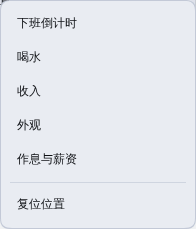
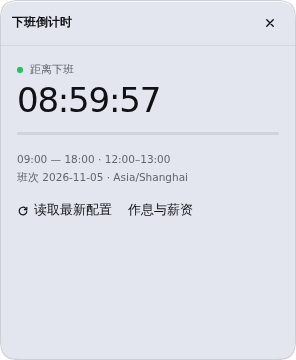
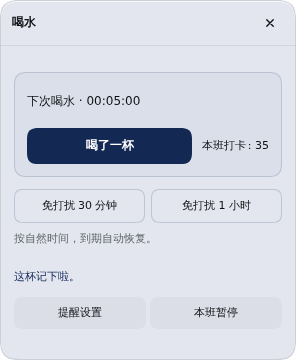
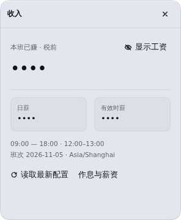

# 独立 Harness 宠物：独立功能卡片

状态：本地开发，待用户体验。保持产品版本 `1.0.1`，不推送、不发布 npm，仅更新指定的 `dsh.toolscc.cn` 开发环境。

## 菜单与卡片

右键菜单继续使用一行一项，菜单入口与卡片一一对应：

| 菜单       | 卡片内容                                                             |
| ---------- | -------------------------------------------------------------------- |
| 下班倒计时 | 下班时间、班次进度与作息信息，不包含喝水或收入                       |
| 喝水       | 打卡、下次喝水、本班次数、免打扰、本班暂停/恢复与提醒设置            |
| 收入       | 本班收入、日薪、有效时薪，金额仍按原偏好隐藏，不显示倒计时或喝水操作 |
| 外观       | 独立预览和应用角色、大小、动作及透明度                               |
| 作息与薪资 | 独立编辑作息和计薪配置                                               |
| 复位位置   | 工具操作，直接复位宠物                                               |

不再使用混合主页或在各卡片底部排列其他功能入口。一次只打开所选卡片。左键宠物直接打开喝水卡片，点击脚下的倒计时直接打开倒计时卡片。

## 返回与提醒

- 菜单打开的是独立顶层卡片，没有返回其他功能的按钮。外观应用或取消后收起自身卡片。
- 从喝水卡片进入提醒设置，返回只回喝水；从倒计时或收入进入作息配置，返回各自原卡片。
- 草稿保护继续有效：内部跳转、返回、关闭和 Escape 遇到未保存修改时，提供保存并继续、放弃修改或继续编辑。
- 查看倒计时或收入时，喝水到期只在宠物旁显示独立提示按钮。点击才进入喝水卡片，不向当前卡片插入喝水控件。
- 没有打开其他卡片时，到期仍可显示独立提醒气泡；关闭提醒气泡会执行已有的“工作 10 分钟后”。同一提醒继续只由一个标签页显示。

## 交互规则

- 右键和 Shift+F10 / 菜单键打开小菜单，方向键导航，Enter 执行，Escape 收起。
- 菜单优先避开宠物，组件内非文本编辑区域拦截浏览器菜单。
- 拖动只改变位置，松开持久化；方向键微调，Home 复位。
- 卡片边界固定，内容滚动，标题栏始终可见。卡片不显示滚动条；较长的设置页仍支持滚轮、触控和键盘滚动，保存按钮保持可达。打卡反馈不改变主要按钮位置。
- 外观先预览再应用，取消还原；模式切换应用后发生。
- 关闭宠物模式可使用原计时卡片。个人设置、记录和工资隐藏状态保留。

## 实现与独立性

宠物代码、角色与交互由本项目自主实现，没有调用其他宠物插件的服务或复制其素材。当前使用原创 SVG“小歇”，外部模型包导入和 Live2D/视频/序列帧渲染尚未开放。

`pet-interactions.js` 管理唯一活动卡片、返回目标、菜单和待确认导航。菜单导航携带独立根入口标记，草稿确认后也保留该标记。内部路由 `home` 为喝水卡片、`income` 为倒计时卡片、`earnings` 为收入卡片；`water` 为喝水设置子页。

计薪、喝水、IndexedDB、跨标签页租约沿用已有模块。此次主要调整界面与导航，不改变计算规则或用户数据。

## 示例截图

截图来自隔离 Harness，使用示例数据。

## 验证

- 121 项检查通过，含既有业务、交互、草稿及布局回归，新增独立根卡片导航与待确认跳转标记测试。
- 隔离 Harness + Chromium 验证菜单逐项打开、各卡片不包含其他模块内容、提醒设置返回、跨卡片跳转保护草稿、收入隐藏、顶层外观独立关闭。
- 验证宠物/倒计时左键入口分别正确，查看倒计时时到期提示独立呈现，点击提示后仅记录一次。
- 两标签页分别查看倒计时时，共享一个喝水提示。
- 320px 下逐一检查倒计时、喝水、收入与外观卡片的边界。
- 前一轮交互重构已验证存储失败重试、外观预览取消/应用、拖动不误触、键盘与多标签草稿保留。本轮沿用这些机制。
