# 独立 Harness 宠物：独立功能卡片

状态：1.1.1已发布角色、交互和透明视频基线。当前开发版加入动作试播、按需加载与衔接优化，并保留最新到期提醒修复，尚未另发npm版本；详见 [体验优化](EXPERIENCE-PREVIEW.md)。

## 独立喝水与抽烟倒计时

角色下方统一为两层计时面板：上方整行显示下班倒计时，下方左右并排显示喝水和抽烟图标计时。右键菜单“喝水倒计时”和“抽烟倒计时”打开各自卡片；关闭卡片后仍保留计时行。喝水复用已有提醒记录和工作时间规则；抽烟手动开始、按自然时间计时，支持暂停/继续、重新计时和停止，刷新与多标签页保持进度。详情见 [独立倒计时说明](COUNTDOWN-PREVIEW.md)。

## 外观动作试播

选择动态形象后，在预览图下方点击“待机”“挥手”或“喝茶”，可查看已有动作；“停止”立即回到静态图。没有待机视频的形象不显示待机试播按钮。

试播只在外观卡片里播放，不增加喝水次数，也不改变页面上已保存的角色。切换模型、取消、进入草稿确认或切到后台会停止试播，继续编辑不会重播旧动作；只有“应用外观”才保存选择。关闭动作或启用系统减少动态效果时显示静态预览。加载失败可以重试。

视频使用同源内容指纹地址按需读取并缓存，静态启动和仅选择草稿不会请求整套视频。新动作未准备好时保留当前画面，准备好后再交接，减少静态闪回。

## 刷新后的默认界面

- 先恢复浏览器外观偏好，再显示已选宠物；读取Host设置时显示小型加载状态，不退回旧式喝水卡片。
- 设置读取失败、没有会话或还未配置作息时，也保留宠物。失败可从右键菜单“重新读取”恢复；未配置时从“作息与薪资”进入设置。
- 页面正常计时到点后，自动弹出带“喝了／工作10分钟后”的提醒卡，不抢输入焦点。已有卡片、菜单或编辑草稿时不自动覆盖，保留小提示。
- 刷新时已经逾期，或在后台错过到期时，先保留宠物和小提示。点击提示或用Enter/Space激活即可直接展开提醒；其他只读卡片打开时，明确点击提示会进入喝水卡片。
- “收起提醒”和Escape仅收起显示，不打卡、不延期，同一轮持续到期状态不反复弹出。确认“喝了”才记录一次，“工作10分钟后”才延期。
- 用户明确关闭宠物模式时仍使用旧式界面；不重置角色、位置、提醒次数或薪资配置。

## 开发版透明视频形象

在“右键 → 外观 → 角色形象”选择 **鲸蓝少女 · 长裙动态**（原“动态互动”）或 **鲸蓝少女 · 短裙动态**，预览后应用。原有三种静态形象保留，已有用户的角色选择不自动改变。

| 形象     | 待机              | 点击回应            | 打卡成功      |
| -------- | ----------------- | ------------------- | ------------- |
| 长裙动态 | 静态图轻微呼吸    | 挥手5秒             | 喝茶5秒       |
| 短裙动态 | 眨眼、摆尾循环4秒 | 挥手并回到原姿态5秒 | 完整喝茶7.5秒 |

- 左键点击角色只播放回应，不打开、关闭或切换功能卡片；Enter/Space行为相同。喝水事务成功才触发喝茶。动作结束返回对应待机，播放结束不会再次记录喝水。
- 喝茶可替换挥手，连续点击不堆积动作。短裙待机不被鼠标靠近反复打断。
- 拖动、打开菜单、编辑、关闭动作、进入免打扰或后台会停止视频。恢复时短裙回到待机，不重播旧的挥手或喝茶。
- 实际解码小型测试视频判断透明通道支持。播放拒绝、加载失败、等待超时都回退静态图；坏片段不反复重试，其他可用动作仍可播放。

短裙待机原片的中段有额外闪光，处理时取前约1.67秒干净片段，以平缓往返映射形成4秒循环；挥手取前约2.25秒并补回程；喝茶原片实际10秒，去掉动作后的停留，保留7.5秒。持杯关键帧另导出1280×1920透明PNG，不用于伪装成动作视频。

白底已在本机抠除，保护白裙和杯子，使用固定缩放、留白与边缘颜色处理。长裙视频480×768，短裙400×640，均为24fps透明VP9、无音频；五段合计约7.04MiB，当前开发版由Harness Host按需提供并支持缓存，不再内嵌进客户端脚本。原片已裁掉的鞋尖/尾尖没有补画，细发丝和运动边缘可能仍有少量痕迹。来源见 [素材说明](../assets/animations/NOTICE.md)。

外观存储升级到v7，依次读取v6/v5/v4及旧v3格式，保留角色、隐私、位置、大小和动作选择。旧标签页写旧版本不会覆盖新的短裙形象；喝水存储和Host薪资格式不变。

## 开发版交互动作

- 正常待机时轻微呼吸浮动；鼠标靠近会回应，左键点击只打招呼。
- 拖动时轻微倾斜，正常放下后回弹；取消拖动不播放落下动作，拖动不会误开卡片。
- 只有喝水事务成功后才播放一次庆祝反馈，动作本身不修改次数、提醒或薪资。
- 免打扰、休息状态不循环待机动作；编辑设置、打开菜单、页面隐藏、关闭动作或系统减少动态效果时停止动作。恢复后不重播旧反馈。
- 角色节点在每秒计时和状态变化之间保持稳定；新动作可以替换旧动作，取消和清理不会误结束后来的动作。
- 在“外观 → 角色动作反馈”中关闭动作。外观默认显示静态预览，动态形象可主动试播；取消不修改已保存偏好。

这是原有三种静态形象的整体交互动作；长裙动态、短裙动态使用上方对应的视频。

## 菜单与卡片

右键菜单继续使用一行一项，菜单入口与卡片一一对应：

| 菜单       | 卡片内容                                                             |
| ---------- | -------------------------------------------------------------------- |
| 下班倒计时 | 下班时间、班次进度与作息信息，不包含喝水或收入                       |
| 喝水       | 打卡、下次喝水、本班次数、免打扰、本班暂停/恢复与提醒设置            |
| 收入       | 本班收入、日薪、有效时薪，金额仍按原偏好隐藏，不显示倒计时或喝水操作 |
| 外观       | 独立预览和应用角色、大小、动作及透明度                               |
| 作息与薪资 | 独立编辑作息和计薪配置                                               |
| 喝水倒计时 | 独立剩余时间、打卡及原提醒设置入口                                   |
| 抽烟倒计时 | 自然时间计时、间隔设置、暂停/继续、重新计时与停止                    |
| 复位位置   | 工具操作，直接复位宠物                                               |

一次只打开所选卡片。主动打开功能卡片统一使用右键菜单（或Shift+F10/菜单键）。左键角色只互动，脚下倒计时仅显示信息，点击不导航。已有卡片、草稿和确认框不受角色左键影响。

## 返回与提醒

- 菜单打开的是独立顶层卡片，没有返回其他功能的按钮。外观应用或取消后收起自身卡片。
- 从喝水卡片进入提醒设置，返回只回喝水；从倒计时或收入进入作息配置，返回各自原卡片。
- 草稿保护继续有效：内部跳转、返回、关闭和 Escape 遇到未保存修改时，提供保存并继续、放弃修改或继续编辑。
- 查看其他卡片时，到期显示独立提示，不自动切换当前内容。明确点击提示可进入喝水卡片，右键菜单也保留喝水入口。
- 未打开其他卡片且页面经历正常倒计时后，到点自动弹一次提醒卡。同一时刻只有领取显示权的标签页显示提醒；收起后保留提示，待用户打卡、稍后或执行其他明确操作。

## 交互规则

- 右键和 Shift+F10 / 菜单键打开小菜单，方向键导航，Enter 执行，Escape 收起。
- 菜单优先避开宠物，组件内非文本编辑区域拦截浏览器菜单。
- 拖动只改变位置，松开持久化；方向键微调，Home 复位。
- 卡片按实际内容自适应高度，按功能和窗口空间选择宽度；短卡不留大块空白，长表单仅在超出可视区域时滚动，标题和保存入口保持可用。可见滚动条仍隐藏，保留滚轮、触控和键盘操作。
- 外观先在卡片内预览再应用，取消还原；调节大小时页面上的宠物和面板不会跟着移动，模式切换应用后发生。
- 菜单和卡片共用背景、边框、圆角、阴影、字体、按钮与焦点样式，跟随 Harness 主题变量。菜单保持一行一项，并按实际尺寸靠近触发位置摆放。
- 定位统一考虑可视视口及其偏移；窗口缩放、横竖屏和模拟软键盘区域改变时重新适配，不覆盖用户保存的位置。
- 关闭宠物模式可使用原计时卡片。个人设置、记录和工资隐藏状态保留。

## 实现与独立性

宠物展示与交互代码由本项目自主实现，没有调用其他宠物插件的服务或复制其素材。现提供用户给出的两张鲸系少女透明立绘，并保留原创 SVG“小歇”。默认使用长裙立绘，另一张礼裙立绘可在“外观 → 角色形象”中选择。图片来源与使用范围见 [角色素材说明](../assets/characters/NOTICE.md)。外部模型包导入和 Live2D/序列帧渲染尚未开放；内置透明视频仅用于新增的动态互动形象。

两张原图都有有效透明通道。长裙版轮廓清楚、鲸尾外伸，适合默认小尺寸显示；礼裙版饰件和褶皱更丰富。仅清理极低透明度噪点、裁切留白并等比压缩为 640×1024 WebP，不重绘人物。资源内嵌客户端，不依赖外部分享链接。人物保持完整纵向比例，动作反馈是轻微整体位移，不是独立眨眼或摆尾。

角色选择遵循预览、应用、取消及草稿保护规则；预览时不改变页面上的已保存角色。外观偏好使用 v7，迁移保留规则见上方说明。

`pet-surfaces.js` 统一菜单、卡片和通知的尺寸与定位，使用自然内容测量，避免测量受限面板造成循环。`pet-interactions.js` 保留唯一活动卡片、返回目标、菜单和待确认导航。菜单导航携带独立根入口标记，草稿确认后也保留该标记。内部路由 `home` 为喝水卡片、`income` 为倒计时卡片、`earnings` 为收入卡片；`water` 为喝水设置子页。

计薪、喝水、IndexedDB、跨标签页租约沿用已有模块。此次主要调整界面与导航，不改变计算规则或用户数据。

## 示例截图

截图来自隔离 Harness，使用示例数据。

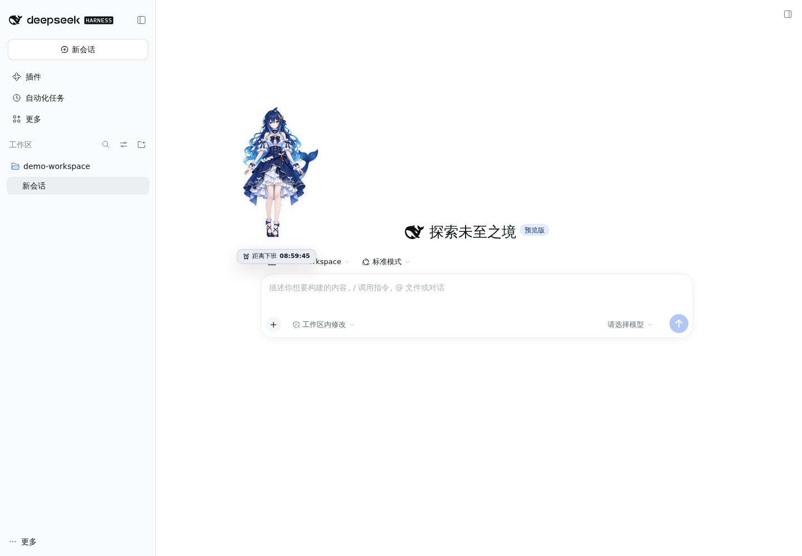

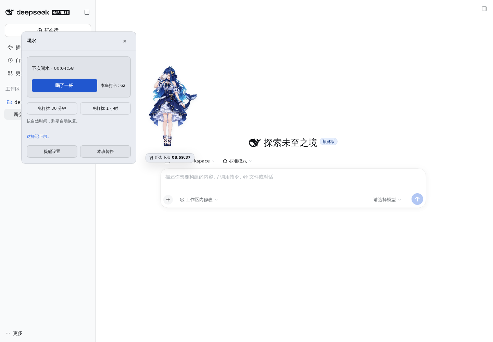

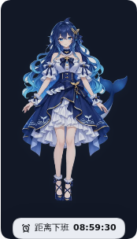

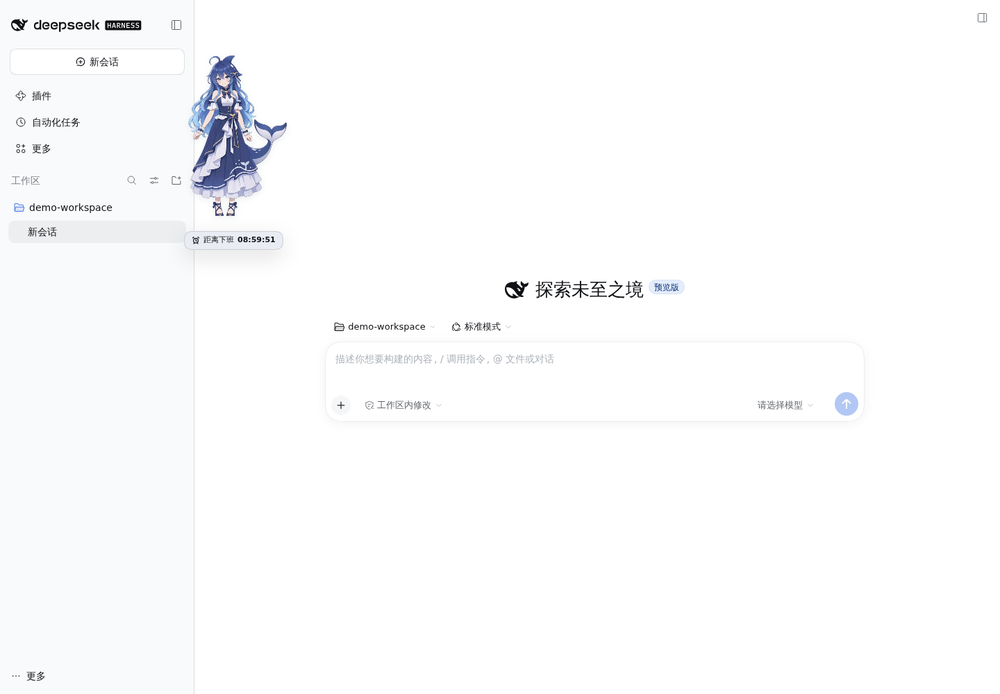

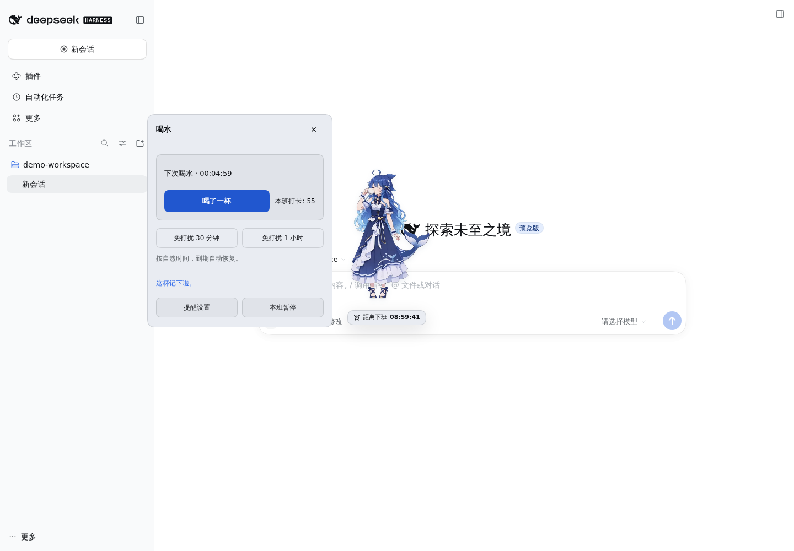

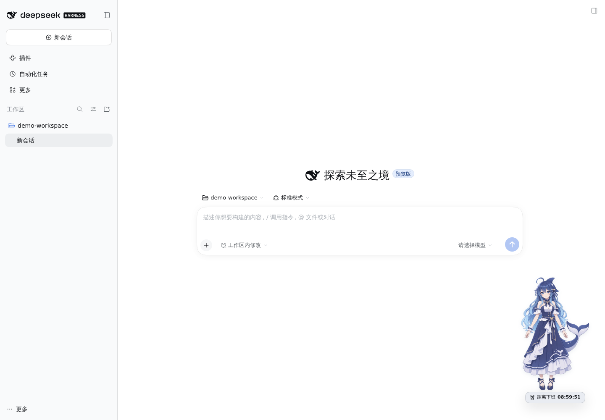

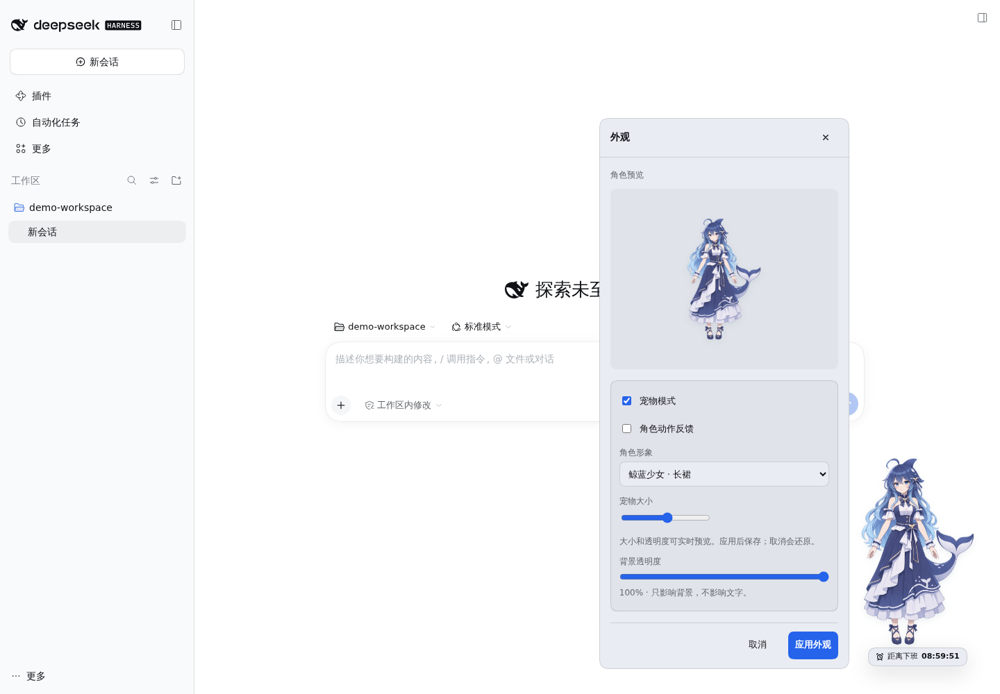

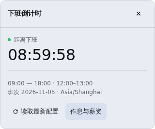

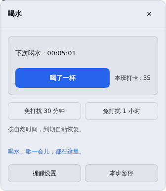

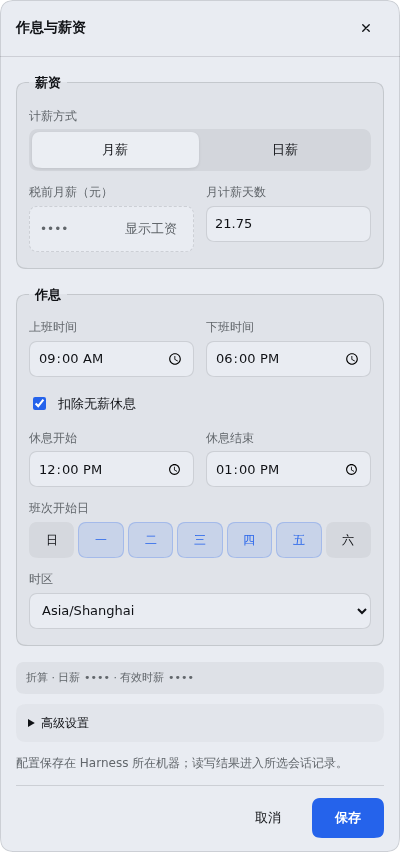

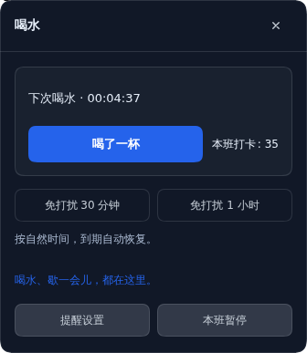

## 验证

- 刷新专项复现了旧版在Host读取期间显示经典卡片的问题；新实现验证慢读取、读取失败/重试、未配置作息、无会话和明确选择经典模式。
- 当前168项检查通过，新增独立倒计时的时间推进、持久化、同步及隔离验证；此前163项覆盖资源清单/完整性、Range/HEAD/ETag、非法路径、试播生命周期、失败重试和新旧画面衔接。
- 独立浏览器验证试播不写记录或偏好、只请求对应视频、缓存复用、加载中换模型、未保存确认后继续编辑、窄屏对齐和真实打卡。
- 保留页面内提醒呈现测试：刷新逾期抑制、到点与显示权、收起不重弹、后台/编辑抑制，以及休息/免打扰结束后提醒。
- 浏览器验证正常到点弹卡但不抢输入焦点、收起不打卡/不延期、点击/键盘提示直接展开、稍后与喝水确认、刷新不闪弹、草稿不被覆盖、两标签仅一张提醒，以及320px边界。
- 到期刷新不重置次数或延后到期时间；从提示或菜单进入后打卡只记一次。
- 五种角色的左键/键盘、拖动、菜单、草稿与窄屏回归通过。

- 1.1.1基线的146项检查涵盖待机循环/动作恢复、后台只恢复待机、拖动与免打扰抑制循环、待机卡顿回退、失败动作与待机协调。
- 浏览器验证短裙连续循环两轮不重建视频节点、挥手返回待机、7.5秒喝茶不被反馈到期打断且只记录一次、背景/减少动态/拖动/免打扰恢复待机、320px边界及刷新保留。
- v6/v5/v4→v7迁移保留偏好，新旧标签隔离、新标签同步短裙形象通过；模拟透明通道不支持与播放拒绝，确认自动待机不会进入重试循环。
- 原有长裙透明通道检测、视频抢占、过期回调、关闭与销毁、播放失败与超时回退测试及浏览器回归通过。
- 浏览器验证透明视频实际解码、预览取消/应用、刷新、挥手切换喝茶、结束回图且不重复打卡、免打扰/拖动/后台/减少动态取消、禁用动作和320px边界。
- 模拟不透明视频解码与播放拒绝，验证回退可见、不反复加载坏媒体；验证v5/v4→v6保留偏好、旧标签隔离和新标签同步视频形象。
- 原有动作抢占、拖动释放、后台/动态偏好取消、静态回退及角色节点稳定性测试继续通过。
- 交互动作浏览器验证：待机、靠近/点击回应、喝水仅一次反馈、拖动倾斜与落下、关闭动作及刷新保留、系统动态偏好实时变化、模拟后台切换与 320px 边界。
- 人物比例与边界、旧偏好默认值保留、图片渲染与 SVG 回退测试继续通过。
- 人物立绘浏览器验证：两张 WebP 解码、预览不改变已保存角色、取消、应用与刷新、SVG 切换、拖动持久化、喝水打卡、窄屏与横屏五张卡片、减少动态效果设置。
- 单独验证 v4→v5 迁移保留偏好、旧版本标签页不能覆盖新偏好、新版本两标签页同步角色选择。
- 前轮布局测试覆盖真实内容高度、卡片宽度、菜单与宠物避让、通知与打开卡片避让、视口偏移和稳定布局；旧菜单估算定位测试已替换。
- 隔离 Harness + Chromium 验证菜单逐项打开、各卡片不包含其他模块内容、提醒设置返回、跨卡片跳转保护草稿、收入隐藏、顶层外观独立关闭。
- 1.1.1安装包浏览器验证：五种角色左键/Enter/Space只回应，计时徽标不导航，右键菜单打开五种卡片，角色点击不干扰已有卡片、草稿或确认框；拖动不误触，拖动后键盘仍可互动。
- 到期徽标不导航，右键可打开喝水；原自动提醒仍能确认并只记录一次。
- 两标签页分别查看倒计时时，共享一个喝水提示。
- 1440×1000、768×1024、390×844、320×568、640×360 五组窗口尺寸均验证五张卡片；无横向溢出，短内容不多出滚动空间，长表单可到达保存按钮。
- 验证菜单实际高度、菜单与卡片颜色/圆角一致、12 秒计时无持续 ResizeObserver 尺寸变化、大字体和长文案无裁切、暗色主题变量、触控模拟的大点击区域。
- 模拟软键盘可视视口偏移时，原卡片和保存按钮仍可达，临时位移不写回用户位置；切换窗口尺寸不丢草稿或输入焦点。确认未保存内容时 Tab 在确认选项内循环。
- 本轮没有宣称真实 iOS/Android、Safari 或 Firefox 已完成独立验收。
- 前一轮交互重构已验证存储失败重试、外观预览取消/应用、拖动不误触、键盘与多标签草稿保留。本轮沿用这些机制。
