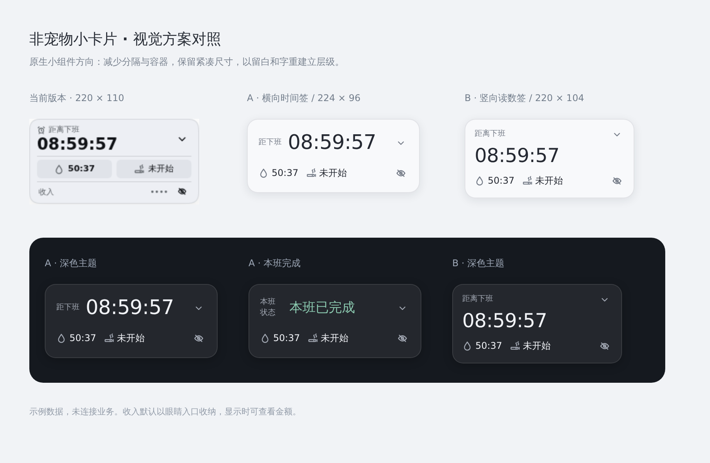
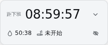
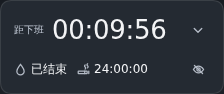

# 小卡片视觉设计评审

用户明确要求使用UI工具或设计评审重新设计，避免继续只调整尺寸。本轮调用独立AI设计评审（Codex CLI，仅读附件截图），然后使用Playwright/Chromium渲染两种HTML/CSS视觉稿，选用横向方案并接入真实Harness。没有使用真人设计服务或Figma连接。

## 评审与选择

初次评审指出：内部灰块像嵌套按钮、数字过粗、分割线切碎空间、收入独占一行。建议以系统字体、较轻字重和留白组织信息，取消内部框线。

比较了横向与竖向两种布局，采用横向布局：

- 默认实测224×94px，主状态与主计时并排；计时26px、字重500，使用等宽数字。
- 下方一行展示水滴和香烟图标计时，不设置常驻灰色底块或分割线。
- 收入默认只留眼睛入口；显示时金额在眼睛旁，可点击进入详情。较长金额缩略显示，悬停及无障碍描述保留完整金额，隐藏时从DOM移除金额。
- 下班后显示“本班已完成”，使用低饱和状态色；不存在用零计时代替状态的问题。
- 使用细边框、轻阴影及主题适配背景，无渐变、外部图片或新运行依赖。
- 完整操作仍通过展开及独立功能卡片提供。发布继续暂停，当前仅更新1.1.1开发预览。

原评审给出的96px包含边框的布局高度；项目边框由背景层绘制，实际布局高度为94px。

## 实际截图复审

将浅色工作中、浅色本班完成、深色长计时和深色完成四张实际浏览器截图再次交给独立AI评审。反馈为可交付，未见必须修正的问题；确认对齐、留白、字重与主题层级协调，24小时长计时未挤压。此结果是AI视觉复审意见，不替代用户的审美判断。

## 验证

171项项目检查通过。实际浏览器验证默认尺寸、展开/收起、计时入口、金额显示/隐藏与详情、外观返回、拖动、本班完成和休息状态；另检查24小时暂停计时、提醒结束状态、窄屏/横屏、深色背景及金额显示后不撑大卡片。

原始建议、两套视觉稿和实际截图保存在`offwork-hydration-artifacts/design-review`。只保存公开界面与示例数据，不归档CLI认证日志或浏览器登录状态。

